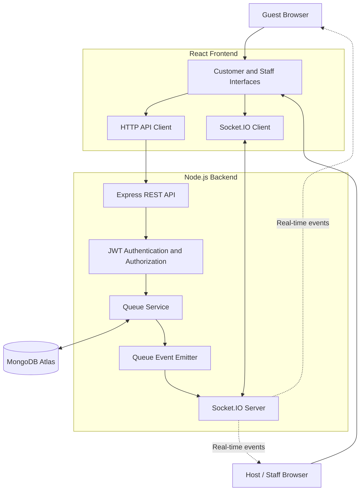
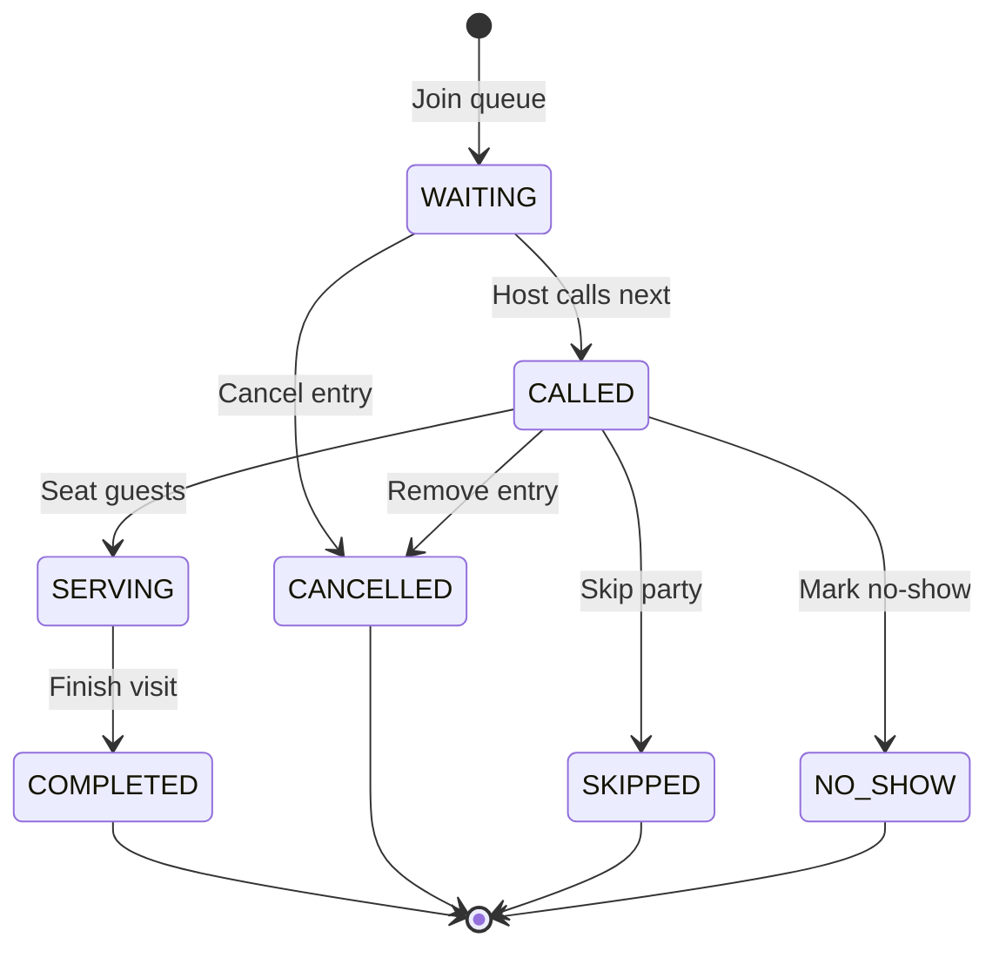

# QueueLess — Real-Time Restaurant Queue Management

**A real-time digital waiting-list platform for restaurant walk-in guests and staff.**

[](https://queue-less-beta.vercel.app)
[](https://queueless-api-399c.onrender.com)
[](https://react.dev/)
[](https://nodejs.org/)
[](https://expressjs.com/)
[](https://www.mongodb.com/)
[](https://socket.io/)

QueueLess is a full-stack web application designed to simplify restaurant walk-in queues. Guests can check in without creating a password, join a digital waiting list, and receive live updates as their turn approaches. Restaurant staff can manage the waiting list, call the next party, seat guests, and complete queue entries from a dedicated host dashboard.

The project combines REST APIs, persistent database storage, JWT authentication, role-based authorization, and Socket.IO to deliver a responsive, real-time queue management experience.

**Live application:** https://queue-less-beta.vercel.app

---

## Table of Contents

- [Overview](#overview)
- [Problem Statement](#problem-statement)
- [Key Features](#key-features)
- [Application Screenshots](#application-screenshots)
- [How It Works](#how-it-works)
- [System Architecture](#system-architecture)
- [Technology Stack](#technology-stack)
- [Queue Lifecycle](#queue-lifecycle)
- [Project Structure](#project-structure)
- [Getting Started](#getting-started)
- [Environment Variables](#environment-variables)
- [API Reference](#api-reference)
- [Real-Time Communication](#real-time-communication)
- [Security and Data Integrity](#security-and-data-integrity)
- [Testing](#testing)
- [Deployment](#deployment)
- [Current Scope and Future Improvements](#current-scope-and-future-improvements)
- [Author](#author)

---

## Overview

QueueLess replaces an unstructured, physical waiting line with a digital queue that guests and restaurant staff can access from their own devices.

The demonstration environment uses **The Garden Table**, a restaurant with two waiting-list services:

- **Main Dining** — token prefix `A`
- **Outdoor Dining** — token prefix `B`

Each service maintains its own queue and token sequence. Guests can check in, choose a service, and follow their queue status while staff manage the flow of parties through the restaurant.

The application is built as a full-stack project with a React frontend, a Node.js and Express backend, MongoDB persistence, and Socket.IO for real-time updates.

## Problem Statement

Traditional restaurant waiting lists often rely on paper lists, verbal communication, or manual tracking. These approaches can make it difficult to keep guests informed, coordinate staff actions, and maintain a consistent view of the queue across multiple devices.

QueueLess addresses these problems by providing:

- Digital guest check-in.
- Persistent, uniquely numbered queue tokens.
- Live queue status and position updates.
- A centralized interface for restaurant staff.
- Real-time synchronization between guests and the host stand.
- Server-side validation of queue transitions and user permissions.

## Key Features

### Guest experience

- **Passwordless check-in:** Guests identify themselves using their name and email address.
- **Digital waiting list:** Join an available dining service and receive a token.
- **Queue tracking:** View the current queue status and position.
- **Live notifications:** See queue changes without manually refreshing the page.
- **Cancellation:** Cancel an eligible active queue entry.
- **Responsive interface:** Access the application from desktop and mobile browsers.

### Host and staff experience

- **Live waiting list:** View parties currently waiting for a table.
- **Call the next party:** Advance the queue in the correct waiting order.
- **Seat guests:** Move a called party into the seated state.
- **Complete entries:** Clear completed parties from the active queue.
- **Remove parties:** Cancel eligible entries when necessary.
- **Operational overview:** View waiting, table-ready, seated, and cleared-today counts.
- **Queue history:** Review completed entries represented in the staff dashboard.

### Backend and reliability

- RESTful API endpoints for authentication and queue operations.
- MongoDB persistence through Mongoose.
- JWT-based authentication.
- Role-based authorization for staff and administrators.
- Real-time event delivery using Socket.IO.
- Atomic token-number allocation for concurrent joins.
- Database uniqueness constraints to prevent duplicate token numbers within a service.
- Validation of queue state transitions.
- Centralized error handling.

---

## Application Screenshots

Add screenshots here after capturing the final deployed interface. These help visitors understand the application before reading the implementation details.

### 1. Guest Check-In


*Guest check-in interface for joining the restaurant waiting list.*

### 2. Guest Queue Dashboard


<!-- Example:  -->

*Token details, queue status, and progress through the waiting process.*

### 3. Host Stand Dashboard


<!-- Example:  -->

*Staff interface for managing waiting parties, calling guests, and seating parties.*


---

## How It Works

1. A guest enters their name and email address on the check-in page.
2. The backend creates or retrieves the guest's account and issues an authentication token.
3. The guest selects an available dining service and joins its waiting list.
4. The backend allocates a token number and stores the queue entry in MongoDB.
5. Socket.IO broadcasts relevant queue-change events to authorized, connected clients.
6. The host calls the next waiting party.
7. The guest's status updates to indicate that the table is ready.
8. Staff seat the party and complete the entry when the visit is finished.

The backend remains the source of truth for queue state. Socket.IO communicates changes, while clients can retrieve authoritative state through the REST API.

## System Architecture



### Architectural responsibilities

| Component | Responsibility |
|---|---|
| React | Customer and staff interfaces |
| Axios / HTTP client | Communication with REST endpoints |
| Express | API routing and request handling |
| Authentication middleware | JWT verification |
| Role middleware | Enforce staff and administrator permissions |
| Queue service | Queue business rules and state transitions |
| Mongoose | Database models, validation, and queries |
| MongoDB Atlas | Persistent application data |
| Socket.IO | Real-time queue events |
| Vercel | Frontend hosting |
| Render | Backend hosting |

---

## Technology Stack

| Area | Technologies |
|---|---|
| Frontend | React, Vite, JavaScript, CSS |
| API communication | Axios |
| Backend | Node.js, Express.js |
| Database | MongoDB Atlas, Mongoose |
| Authentication | JSON Web Tokens (JWT), bcrypt |
| Real-time communication | Socket.IO |
| Frontend deployment | Vercel |
| Backend deployment | Render |
| Version control | Git, GitHub |

---

## Queue Lifecycle

QueueLess models the progress of a party using explicit queue states.



The normal restaurant workflow is:

`WAITING → CALLED → SERVING → COMPLETED`

Alternative transitions handle cancellations, skipped parties, and no-shows. The backend validates transitions rather than allowing clients to set arbitrary queue statuses.

---

## Project Structure

The repository separates the frontend and backend into independent applications.

```text
QueueLess/
├── client/
│   ├── public/
│   ├── src/
│   │   ├── api/
│   │   ├── components/
│   │   ├── context/
│   │   ├── pages/
│   │   ├── styles/
│   │   ├── App.jsx
│   │   └── main.jsx
│   ├── .env.example
│   ├── package.json
│   └── vite.config.js
│
├── server/
│   ├── src/
│   │   ├── config/
│   │   ├── controllers/
│   │   ├── middleware/
│   │   ├── models/
│   │   ├── routes/
│   │   ├── scripts/
│   │   ├── services/
│   │   ├── sockets/
│   │   └── server.js
│   ├── .env.example
│   └── package.json
│
├── .gitignore
├── package.json
├── package-lock.json
└── README.md
```

*Directory names are illustrative; consult the repository for the exact current file layout.*

---

## Getting Started

### Prerequisites

Install the following before running QueueLess locally:

- Node.js and npm.
- A MongoDB Atlas cluster or another compatible MongoDB instance.
- Git.

### 1. Clone the repository

```bash
git clone https://github.com/Rutva-11/QueueLess.git
cd QueueLess
```

### 2. Install dependencies

Install the frontend and backend dependencies separately:

```bash
cd server
npm install
```

Then:

```bash
cd ../client
npm install
```

### 3. Configure the backend

Create `server/.env` using `server/.env.example` as a reference.

Set the MongoDB connection string, JWT secret, and other required settings. Ensure the MongoDB URI specifies the intended database name, such as `queueless`, before its query string.

Do not commit `.env` files or share database credentials.

### 4. Configure the frontend

Create `client/.env` using `client/.env.example` as a reference.

Configure the API URL, Socket.IO URL, and demo service ID as described in the next section.

### 5. Seed the restaurant data

From the `server/` directory, run the seed command:

```bash
npm run seed
```

This initializes the restaurant organization and dining services. Run it only after verifying that your backend environment points to the intended database.

### 6. Start the backend

From `server/`:

```bash
npm start
```

The backend should connect to MongoDB and start listening on the configured port.

### 7. Start the frontend

In another terminal, from `client/`:

```bash
npm run dev
```

Open the local URL printed by Vite in your terminal.

### 8. Create a staff account

Use the staff-seeding script included in the backend:

```bash
cd server
DEV_STAFF_EMAIL="staff@example.com" \
DEV_STAFF_PASSWORD="replace-with-a-strong-password" \
npm run seed:staff
```

Use your own strong development password. Do not use this example password in a real deployment.

Sign in through the staff login page with the credentials you configured. Customer check-in is passwordless; staff and administrators authenticate with a password.

> **Note:** Verify the scripts in `server/package.json` and the variable names in the environment example files if the repository changes.

---

## Environment Variables

### Backend

Configure these in `server/.env` and in the Render environment settings.

| Variable | Purpose |
|---|---|
| `MONGODB_URI` | MongoDB connection string, including the intended database name |
| `JWT_SECRET` | Secret used to sign and verify authentication tokens |
| `JWT_EXPIRES_IN` | JWT expiration duration |
| `PORT` | Backend port; the hosting platform may supply this |
| `CLIENT_ORIGIN` | Permitted frontend origin or origins |

The backend may also support development-only staff-seeding variables, including `DEV_STAFF_EMAIL`, `DEV_STAFF_PASSWORD`, and `DEV_STAFF_ROLE`.

### Frontend

Configure these in `client/.env` and in the Vercel environment settings.

| Variable | Purpose |
|---|---|
| `VITE_API_URL` | Base URL for the backend API, including `/api` |
| `VITE_SOCKET_URL` | Base URL for the Socket.IO server |
| `VITE_DEMO_SERVICE_ID` | Default dining service ID |

Example for the deployed application:

```env
VITE_API_URL=https://queueless-api-399c.onrender.com/api
VITE_SOCKET_URL=https://queueless-api-399c.onrender.com
VITE_DEMO_SERVICE_ID=6ac547fc49a26f5700e59974
```

The service ID above is the configured Main Dining service ID for the current demonstration database. If you reseed a different database or change the service records, verify the ID before using it.

**Important:** Vite exposes variables prefixed with `VITE_` to browser code. Only put public configuration in these variables. Never put passwords, MongoDB credentials, JWT signing secrets, or private API keys in frontend environment variables.

---

## API Reference

Base URL for the deployed backend:

`https://queueless-api-399c.onrender.com`

All endpoints below are relative to the base URL.

### Authentication

| Method | Endpoint | Purpose | Access |
|---|---|---|---|
| `POST` | `/api/auth/customer/check-in` | Passwordless guest check-in | Public |
| `POST` | `/api/auth/register` | Register a password-based user or delegate passwordless check-in | Public |
| `POST` | `/api/auth/login` | Staff/admin login | Public |

### Queue operations

| Method | Endpoint | Purpose | Access |
|---|---|---|---|
| `GET` | `/api/queue/services` | Retrieve available dining services | Authenticated |
| `GET` | `/api/queue/my` | Retrieve the current user's active queue entry | Authenticated |
| `GET` | `/api/queue/service/:serviceId` | Retrieve the active queue for a service | Authenticated |
| `POST` | `/api/queue/join` | Join a dining service queue | Authenticated |
| `POST` | `/api/queue/call-next` | Call the next waiting party | Staff/admin |
| `POST` | `/api/queue/:id/start` | Seat a called party | Staff/admin |
| `POST` | `/api/queue/:id/complete` | Complete a seated party | Staff/admin |
| `POST` | `/api/queue/:id/cancel` | Cancel an eligible queue entry | Authenticated; ownership enforced |

Protected requests use a bearer token:

```http
Authorization: Bearer <JWT>
```

Request bodies and required fields depend on the endpoint. Consult the corresponding route and controller implementation for the authoritative API contract.

### Example: Guest check-in

```bash
curl -X POST \
  "https://queueless-api-399c.onrender.com/api/auth/customer/check-in" \
  -H "Content-Type: application/json" \
  -d '{
    "name": "Demo Guest",
    "email": "demo@example.com"
  }'
```

A successful response includes authentication information. Use the returned token in subsequent protected requests.

### Example: Retrieve dining services

```bash
curl -X GET \
  "https://queueless-api-399c.onrender.com/api/queue/services" \
  -H "Authorization: Bearer <JWT>"
```

---

## Real-Time Communication

Socket.IO keeps connected guest and staff interfaces synchronized as queue operations occur.

The server authenticates socket connections using JWTs and organizes connections into controlled rooms, including:

- `user:<userId>` for user-specific updates.
- `staff` for authorized staff and administrators.
- `service:<serviceId>` for service-specific queue updates.

The application emits events for successful queue mutations, including:

- `queue:joined`
- `queue:called`
- `queue:started`
- `queue:completed`
- `queue:cancelled`
- `queue:updated`

The event payloads are sanitized. Clients use the events to update their view and retrieve authoritative data from the API where necessary.

This approach keeps queue state in MongoDB rather than relying on individual browsers to maintain independent copies of the queue.

---

## Security and Data Integrity

QueueLess incorporates several backend safeguards:

- **JWT authentication:** Protected API requests and socket connections require valid authentication.
- **Role-based authorization:** Staff-only queue operations reject ordinary guest accounts.
- **Ownership checks:** Guests cannot cancel another user's queue entry.
- **Password hashing:** Password-based accounts use bcrypt hashing rather than storing plaintext passwords.
- **State-transition validation:** Queue entries cannot move through arbitrary or invalid status changes.
- **Atomic token allocation:** Database-side atomic increments help prevent token-number collisions during concurrent joins.
- **Unique token constraint:** A compound database index enforces unique token numbers within a service.
- **Duplicate active-entry protection:** Database constraints and backend validation help prevent a guest from maintaining multiple active entries for the same service.
- **Environment-variable protection:** Database credentials and JWT signing secrets belong in server-side environment configuration, not source control.

These safeguards improve reliability and reduce common authorization and data-integrity risks. They do not replace a full independent security audit.

---

## Testing

The project has been exercised against several important scenarios during development:

- Customer check-in and authentication.
- Authorized and unauthorized staff actions.
- Valid and invalid queue state transitions.
- Guest cancellation and ownership enforcement.
- Real-time queue updates.
- Socket reconnection and restoration of current queue state.
- Duplicate active joins.
- Concurrent queue joins and token allocation.
- Persistence and database consistency.
- Frontend build and regression checks.

The development validation included a concurrent-join test with 20 simultaneous requests, with unique sequential token allocation verified in that test run.

Automated test scripts are maintained in the repository. To run them, inspect the `scripts` section of the relevant `package.json` and execute the corresponding commands from that application's directory.

---

## Deployment

QueueLess is deployed as two applications.

| Application | Platform | URL |
|---|---|---|
| Frontend | Vercel | https://queue-less-beta.vercel.app |
| Backend API | Render | https://queueless-api-399c.onrender.com |
| Database | MongoDB Atlas | Configured server-side |

### Deployment workflow

1. Push the reviewed changes to the GitHub branch connected to the hosting platforms.
2. Vercel builds and deploys the frontend.
3. Render builds and deploys the backend.
4. Verify the environment variables on both platforms.
5. Confirm that the backend connects to the intended MongoDB database.
6. Check the API and test guest check-in, queue joining, staff operations, and real-time updates.

When changing frontend environment variables, trigger a new Vercel build because Vite embeds them in the frontend bundle during compilation.

**Free-tier note:** The Render service may spin down after inactivity, causing a delay on the first request. This is a hosting limitation rather than necessarily an application error.

---

## Current Scope and Future Improvements

QueueLess currently focuses on the core digital waiting-list workflow for a restaurant.

Potential future improvements include:

- Estimated wait times that adapt to actual service durations.
- More detailed seated-party and completed-party history.
- Better queue analytics and operational reporting.
- Appointment booking and scheduled arrivals.
- Configurable restaurant services and multiple counters.
- Email or SMS notifications.
- Progressive Web App capabilities.
- Expanded integration and end-to-end test coverage.
- Production monitoring, rate limiting, and additional security hardening.

These are future directions, not claims about functionality already implemented.

---

## Author

**Rutva Patel**

- GitHub: https://github.com/Rutva-11
- LinkedIn: https://www.linkedin.com/in/rutva-patel-60a1b2325/

---

*QueueLess is a portfolio software project demonstrating full-stack development, REST API design, authentication and authorization, real-time communication, database integrity, and concurrent queue processing.*
